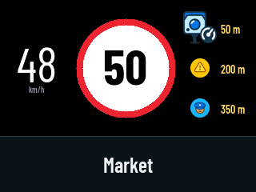
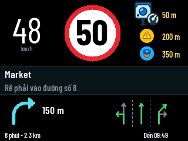
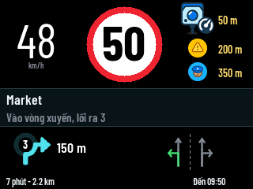
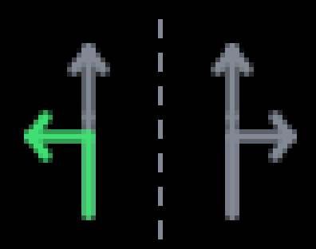
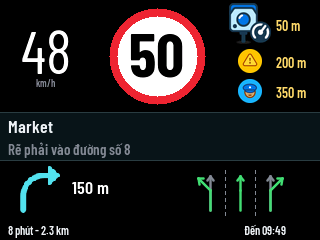
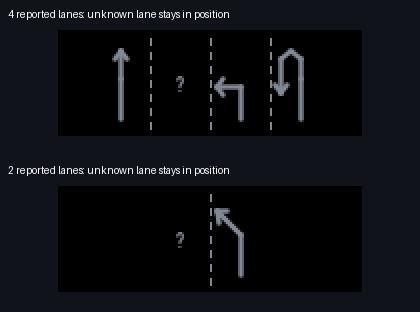
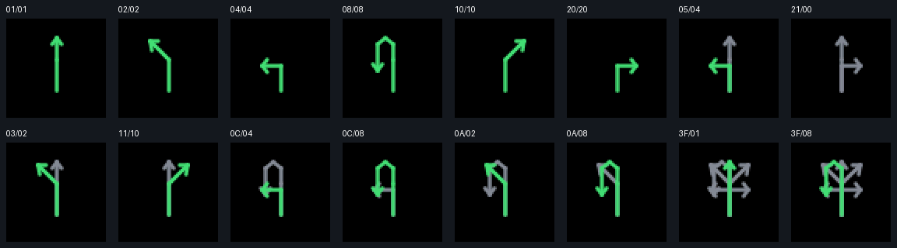

# WazeHUD cho LCDWIKI ES3N28P (ESP32-S3 + màn 2.8" ILI9341V)

> **Repo này được clone và chỉnh sửa từ [ShindouAris/WazeHUD](https://github.com/ShindouAris/WazeHUD).**
> Toàn bộ ý tưởng gốc, giao thức HLP/1 và kiến trúc firmware thuộc về tác giả gốc; fork này đổi phần cứng đích, thiết kế lại giao diện và bổ sung nhiều cải tiến. Giấy phép: GNU GPL v3 (xem [LICENSE](LICENSE)).

Firmware ESP-IDF biến board **LCDWIKI ES3N28P** (ESP32-S3 N16R8, LCD 2.8" 240×320, không cảm ứng) thành màn hình HUD Bluetooth cho Waze mod hỗ trợ HLP/1. Thiết bị nhận dữ liệu dẫn đường qua BLE (quảng bá với tên **`WazeHUD`**) và hiển thị tốc độ, biển giới hạn, cảnh báo, hướng rẽ, làn đường, tên đường và ETA.

> [!IMPORTANT]
> Đây là màn hình hỗ trợ thông tin, không thay thế việc quan sát biển báo, giao thông và các quyết định lái xe an toàn.

> [!NOTE]
> Các ảnh bên dưới được render từ **chính renderer C++ của firmware** chạy trên máy host (`waze-hud/tools/check_free_driving.py`) với dữ liệu mẫu, không phải ảnh chụp màn hình thật. Giao diện thực tế trên LCD cần kiểm tra bằng mắt.

## Khác biệt so với bản gốc

| Hạng mục | Bản gốc | Fork này |
| --- | --- | --- |
| Phần cứng | LILYGO T-Display S3 (ST7789, 320×170) | LCDWIKI ES3N28P (ILI9341V, 320×240) |
| ESP-IDF | 5.5.5 | 6.1 (cJSON thành managed component) |
| Giao diện | Bố cục 320×170 nhiều thông tin | Bố cục tối giản 320×240, nền đen tuyệt đối |
| Font | Font cũ | Barlow Condensed (Regular/SemiBold/Bold), có tiếng Việt |
| Lane guidance | Hiển thị cơ bản | Vẽ lại bằng vector, kiểm thử toàn diện |
| Nút bấm / pin | Có (GPIO14 / GPIO4) | Tắt, board này không có |

## Các thay đổi chính

### 1. Giao diện lái xe tự do (không dẫn đường)

Toàn bộ màn 320×240 được tận dụng: tốc độ hiện tại bên trái, biển giới hạn phóng to ở giữa, tối đa 3 cảnh báo bên phải (sắp xếp theo khoảng cách thực, cảnh báo gần nhất dùng asset Large), tên đường bên dưới. Khi bản đồ không có giới hạn tốc độ, biển hiển thị dấu `?`.

<p align="center">
  
</p>

- Tốc độ dùng Barlow Condensed Regular 60 px; viền đỏ biển giới hạn dày 8 px.
- Khi vượt ngưỡng (giới hạn + offset cấu hình), viền màn hình **nhấp nháy đỏ** theo chu kỳ 1,4 giây, dừng ngay khi hết vượt tốc, mất giới hạn hoặc mất kết nối.
- Tên đường căn giữa; nếu quá dài sẽ chạy marquee (dừng 1,2 s, cuộn 1 px/45 ms, giữ cuối 0,9 s, lặp lại).

### 2. Giao diện dẫn đường toàn màn hình

Khi có tuyến, màn hình chia thành: dải tốc độ/giới hạn/cảnh báo, thanh tên đường và chỉ dẫn rẽ tiếng Việt (suy ra từ `trn` và `st2`), hàng hướng rẽ kèm khoảng cách và làn đường, cuối cùng là footer (thời gian còn lại - quãng đường - ETA).

<p align="center">
  
</p>

### 3. Vòng xuyến

Số lối ra được căn theo **tâm vòng** của từng bitmap thay vì tâm cả icon; đã kiểm tra pixel cho cả 5 asset vòng xuyến.

<p align="center">
  
</p>

### 4. Lane guidance vẽ lại và kiểm thử toàn diện

Hỗ trợ 6 hướng HLP (`0x01` thẳng, `0x02` chếch trái, `0x04` trái, `0x08` quay đầu, `0x10` chếch phải, `0x20` phải), tối đa 12 làn. Làn được chọn màu xanh lá, các nhánh còn lại màu xám; nét vẽ khử răng cưa 2,4 px, có vạch phân cách đứt nét.

| Làn trộn lẫn (đã sửa lỗi lem màu) | Tham chiếu đầu mũi tên chếch |
| --- | --- |
|  |  |

Các lỗi đã sửa:

- Đầu mũi tên chếch trái/phải bị quay ngang; nay cánh mũi tên suy ra từ hướng thân.
- Thân chung của làn trộn lẫn bị tô xanh lấn sang nhánh không được chọn.
- Nhánh trái/phải đứng riêng bị thừa một đoạn nhô lên.
- Đầu mũi tên quay đầu và chếch phải bị tràn sang làn bên cạnh ở bố cục chật.
- **Mất làn:** mỗi phần tử trong mảng làn nay luôn giữ đúng vị trí; hướng không hỗ trợ hiển thị bằng dấu `?` xám thay vì bị xóa làm các làn sau dồn sang trái.

| Giữ nguyên số làn (4 làn, 2 làn có `?`) |
| --- |
|  |

Bộ kiểm thử `tools/check_lane_arrows.py` bao phủ toàn bộ 728 cặp mask hợp lệ × 12 số làn (8.736 trường hợp render), 65.536 cặp byte cho decoder, dữ liệu sai định dạng và giới hạn dung lượng. Chi tiết xem [previews/lane_review/REVIEW.md](previews/lane_review/REVIEW.md).

<p align="center">
  
</p>

### 5. Font, asset và hiệu năng

- Toàn bộ font dùng Barlow Condensed (giấy phép OFL, kèm trong `waze-hud/main/assets/fonts/`), có đầy đủ ký tự tiếng Việt. Ký tự `·` không có trong font nên footer dùng dấu gạch nối ASCII.
- Frame buffer toàn màn hình nằm trong PSRAM; SPI truyền qua stripe buffer DMA nội bộ, byte RGB565 được hoán đổi sẵn.
- Mở rộng decoder HLP: thêm cảnh báo đèn giao thông (type 75), quay đầu, kẹt xe nhiều mức độ.
- Offset ngưỡng cảnh báo tốc độ, độ sáng, phản chiếu và xoay 180° vẫn chỉnh được từ ứng dụng qua `device_config` (lưu NVS).

## Phần cứng

| Thành phần | Chi tiết |
| --- | --- |
| Board | LCDWIKI ES3N28P, ESP32-S3 N16R8 (flash 16 MB, PSRAM 8 MB) |
| LCD | ILI9341V 240×320, SPI 20 MHz |
| Chân LCD | SCLK GPIO12, MOSI GPIO11, CS GPIO10, DC GPIO46, BL GPIO45 (active high) |
| Reset | Dùng chung CHIP_PU, driver dùng software reset |

Nguồn pin: <https://www.lcdwiki.com/2.8inch_ESP32-S3_Display>. Board không có nút KEY và mạch đo pin nên hai tính năng này bị tắt.

## Bắt đầu nhanh

### Flash firmware dựng sẵn

Thư mục [firmware/](firmware/) chứa bản production mới nhất (`WazeHUD-ES3N28P-production-2026-11-17`) gồm file BIN gộp, `SHA256SUMS.txt` và README riêng. Kiểm tra checksum rồi flash tại địa chỉ `0x0`:

```sh
python -m esptool --chip esp32s3 --port /dev/cu.usbmodem3141201 --baud 460800 \
  write-flash --flash-mode dio --flash-freq 80m --flash-size 16MB \
  0x0 WazeHUD-ES3N28P-production.bin
```

Đổi cổng cho phù hợp (ví dụ `COM3` trên Windows). Nếu cần vào download mode: giữ BOOT rồi nhấn RESET. Lưu ý: flash image gộp sẽ **xóa cấu hình NVS** đã lưu.

### Kết nối ứng dụng

1. Bật Bluetooth trên điện thoại.
2. Mở Waze mod/producer hỗ trợ HLP/1.
3. Kết nối tới `WazeHUD` và bật notifications cho characteristic RX.
4. Khi bắt đầu dẫn đường, HUD tự chuyển sang giao diện dẫn đường.

## Tự build (ESP-IDF 6.1)

Kích hoạt môi trường ESP-IDF 6.1, rồi tại thư mục `waze-hud`:

```sh
idf.py -B build-es3n28p -D SDKCONFIG=sdkconfig.es3n28p \
  -D 'SDKCONFIG_DEFAULTS=sdkconfig.defaults;sdkconfig.es3n28p.defaults' build
idf.py -B build-es3n28p -p /dev/cu.usbmodem3141201 flash
idf.py -B build-es3n28p -p /dev/cu.usbmodem3141201 monitor
```

Chi tiết cấu hình, nhật ký kiểm chứng và lịch sử cải tiến UI: [waze-hud/BUILD_ES3N28P.md](waze-hud/BUILD_ES3N28P.md).

### Mock UI (không cần điện thoại)

Chu kỳ 20 tình huống (rẽ, quay đầu, vòng xuyến, camera, cảnh sát, cấm vượt, kẹt xe, tên đường dài, 6 làn, vượt tốc 3 chữ số…) lặp lại sau 114 giây:

```sh
idf.py -B build-mock -D SDKCONFIG=sdkconfig.mock \
  -D 'SDKCONFIG_DEFAULTS=sdkconfig.defaults;sdkconfig.es3n28p.defaults;sdkconfig.mock.defaults' build
idf.py -B build-mock -p /dev/cu.usbmodem3141201 flash
```

Quay lại firmware BLE bằng lệnh flash `build-es3n28p` ở trên.

### Kiểm thử renderer trên host

```sh
cd waze-hud
python3 tools/check_free_driving.py   # render thật bằng C++, sinh previews/*.png
python3 tools/check_lane_arrows.py    # kiểm thử toàn diện lane guidance
```

## Kiến trúc

```text
Android / Waze mod
        │ BLE GATT
        ▼
NimBLE transport ──► HLP/1 framing + JSON decoder ──► HudState snapshot
                                                              │
                                                              ▼
                                                 Dirty-region HUD renderer
                                                              │
                                                              ▼
                                                  ILI9341V LCD 320×240
```

- BLE callback chỉ sao chép chunk vào queue; không parse JSON hay vẽ LCD trong callback.
- Renderer chỉ nhận `HudState` đã chuẩn hóa, không biết JSON hay BLE.
- Asset và font nhúng dạng RGB565/alpha mask, không decode PNG lúc chạy.

```text
waze-hud/
├── main/
│   ├── bluetooth/   # NimBLE GATT transport
│   ├── protocol/    # HLP/1 framing, handshake, JSON decoder
│   ├── state/       # HudState snapshot thread-safe
│   ├── display/     # ILI9341 driver, layout, font, renderer
│   ├── config/      # Dynamic config + NVS
│   └── assets/      # Font và asset sinh sẵn
└── tools/           # Sinh asset, harness kiểm thử host
previews/            # Ảnh render từ renderer thật
firmware/            # BIN production, checksum
```

## Ghi nhận

- Dự án gốc: [ShindouAris/WazeHUD](https://github.com/ShindouAris/WazeHUD).
- Font: [Barlow Condensed](https://github.com/google/fonts/tree/main/ofl/barlowcondensed) (SIL OFL).
